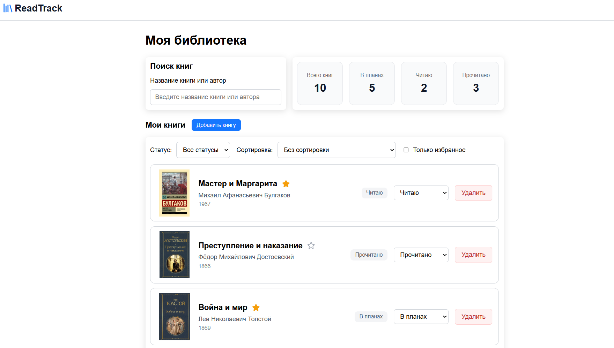

# ReadTrack

Веб-приложение для ведения личной библиотеки. Позволяет добавлять и удалять книги, менять статус чтения, управлять избранным, а также искать, фильтровать и сортировать книги.

## Скриншот главного экрана

<p align="center">
  
</p>

## Возможности

- Добавление и удаление книг;
- Управление статусами чтения: «В планах», «Читаю» и «Прочитано»;
- Поиск книг по названию и автору;
- Фильтрация по статусу чтения и избранному;
- Сортировка по названию или году издания;
- Cтатистика библиотеки по статусам чтения;
- Сохранение избранного в `localStorage`.

## Технологии

React, TypeScript, Vite, Axios, CSS Modules, JSON Server, Sonner, Lucide React.

## Запуск

Установите зависимости:

```bash
npm install
```

Запустите JSON Server:

```bash
npm run server
```

В другом терминале запустите приложение:

```bash
npm run dev
```

Приложение будет доступно по адресу `http://localhost:5173`, API — по адресу `http://localhost:3000`.

## Дополнительные команды

```bash
npm run build   # production-сборка
npm run lint    # проверка кода
npm run preview # просмотр собранного приложения
```
